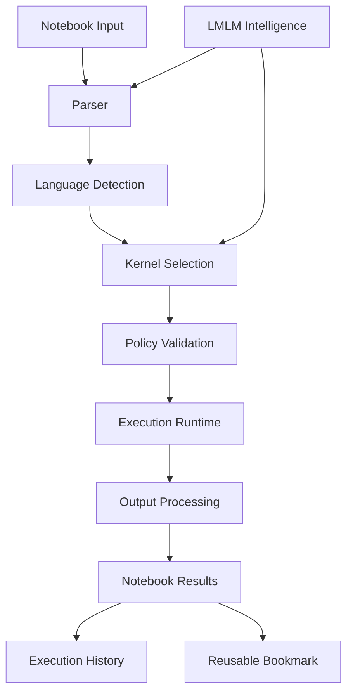

* NoteBookmarks — a standalone, reusable database-query management module.
* Intelligent Notebook Engine — a broader execution environment supporting SQL, Python, AI-generated queries, reusable workflows and multimodal operations.

The two should share a common execution runtime rather than become separate, disconnected systems.

NotebookLMLM — Unified Architecture

# NotebookLMLM

INTELLIGENT MULTIMODAL NOTEBOOK ENVIRONMENT

# NoteBookmarks

Query storage, parameters, templates, versioning.

# Notebook Engine

Cells, documents, interactive execution and outputs.

# Language Kernels

SQL, Python and extensible language runtimes.

# LMLM Intelligence

Query generation, reasoning, analysis and assistance.

# Unified Execution Runtime

Scheduling · permissions · resource management · state · logs · reproducibility

# Data & Integration Layer

PostgreSQL · SQLite · MySQL · files · APIs · local models · authorized external services

1.# NoteBookmarks — standalone module

Independent reusable component

It should work independently and also integrate into the notebook.

# Core features:

Component	Responsibility
Bookmark Registry	Create, edit, delete and organize bookmarks
Query Templates	Store reusable SQL and other query templates
Variable Engine	Resolve named parameters
Linked Tables	Associate bookmarks with database tables
Bookmark Collections	Group bookmarks into projects and folders
Version Manager	Track changes and restore previous queries
Execution History	Track executions, results and errors
Access Control	User permissions and database-level restrictions

Suggested bookmark structure:
```jq
{
  "id": "bookmark_001",
  "name": "customer_search",
  "type": "sql",
  "language": "postgresql",
  "query": "SELECT * FROM customers WHERE name LIKE :name",
  "parameters": {
    "name": {
      "type": "string",
      "required": true
    }
  },
  "database": "primary",
  "version": 1,
  "permissions": {
    "read": true,
    "write": false
  }
}
```
2. # Intelligent Notebook Engine

This is the larger environment.

# Interactive notebook

Markdown, code cells, execution outputs, variables, attachments and reusable notebooks.

# Python execution

Data processing, NumPy, Pandas, machine learning, visualization and scientific computing.

# SQL execution

Query databases, browse tables, manage saved queries and analyze results.

# LMLM AI assistant

Generate code, explain errors, create SQL queries, analyze datasets and orchestrate multi-step workflows.

3. Language kernel architecture

Use a kernel abstraction so new languages can be integrated without rewriting the notebook engine.
```
Kernel	Purpose
Python	Scientific computing and AI
SQL	Database operations
JavaScript / TypeScript	Application development
R	Statistical computing
Bash	System automation
LMLM-Lang	Native LMLM instructions and orchestration
```
Each kernel should expose a common interface:
```
class NotebookKernel:
    def initialize(self, config):
        raise NotImplementedError
    def execute(self, code, context):
        raise NotImplementedError
    def interrupt(self):
        raise NotImplementedError
    def restart(self):
        raise NotImplementedError
    def shutdown(self):
        raise NotImplementedError
```
The interface is illustrative; production kernels should run in isolated processes or containers.

4. Unified execution workflow

This allows LMLM to assist with execution without bypassing runtime security policies.

5. Proposed internal package structure
```bash
notebooklmlm/
│
├── core/
│   ├── engine.py
│   ├── execution.py
│   ├── scheduler.py
│   ├── session.py
│   └── state.py
│
├── bookmarks/
│   ├── registry.py
│   ├── manager.py
│   ├── templates.py
│   ├── variables.py
│   ├── linked_tables.py
│   └── versioning.py
│
├── notebook/
│   ├── document.py
│   ├── cells.py
│   ├── outputs.py
│   ├── metadata.py
│   └── serialization.py
│
├── kernels/
│   ├── base.py
│   ├── python/
│   ├── sql/
│   ├── javascript/
│   ├── r/
│   ├── bash/
│   └── lmlm_lang/
│
├── intelligence/
│   ├── assistant.py
│   ├── query_generator.py
│   ├── code_analyzer.py
│   ├── error_analyzer.py
│   └── workflow_planner.py
│
├── database/
│   ├── adapters/
│   ├── connections.py
│   ├── migrations/
│   └── models/
│
├── security/
│   ├── sandbox.py
│   ├── permissions.py
│   ├── secrets.py
│   └── audit.py
│
├── api/
├── tests/
├── docs/
└── pyproject.toml
```
6. Important engineering decisions

I recommend these foundations:

* Notebook format: JSON-based document format with versioned schemas.
* Execution: Isolated kernel processes.
* Database: SQLite for local metadata initially, with PostgreSQL support.
* Persistence: Save notebooks, bookmarks, execution metadata and outputs.
* Communication: WebSocket-based execution events.
* Security: Parameterized queries, sandboxing, resource limits and permission checks.
* AI: LMLM-native intelligence integration through a controlled tool interface.
* Reproducibility: Record kernel versions, dependencies, inputs and execution metadata.

One particularly important distinction: a bookmark should store a reusable query definition, while a notebook should store an executable research workflow. A workflow can reference multiple bookmarks.

7. Development roadmap

Phase	Deliverable
1	Core notebook document and cell engine
2	NoteBookmarks registry and variable engine
3	SQL and Python kernels
4	Unified execution runtime
5	LMLM intelligence integration
6	Additional language kernels
7	Security, testing and production packaging

Recommended architecture

Build one platform, two primary subsystems, multiple execution kernels.

This makes NotebookLMLM more than a database query interface. It becomes an intelligent computational environment where saved queries, code, datasets, AI reasoning and repeatable workflows coexist.

The next logical implementation milestone is the NotebookLMLM Core + NoteBookmarks MVP, with SQL and Python kernels, persistent storage, and a shared execution API.
